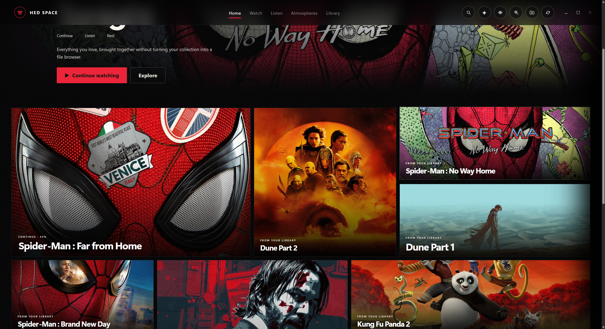
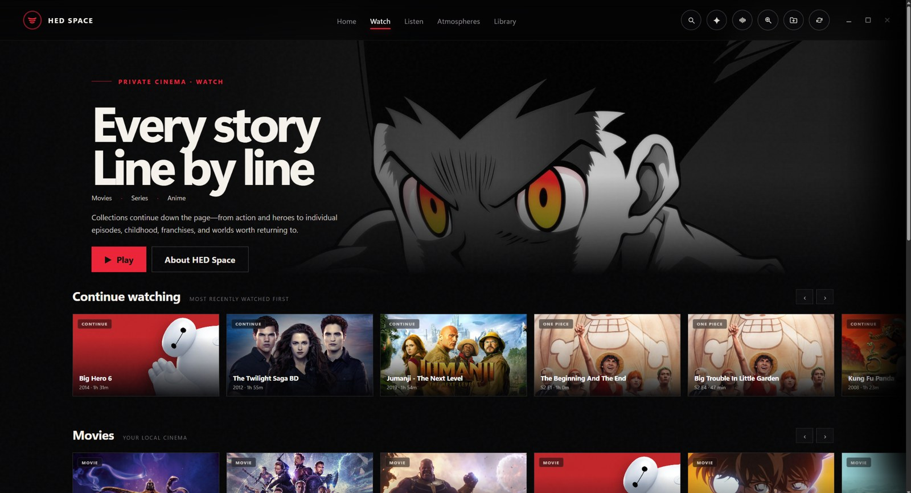
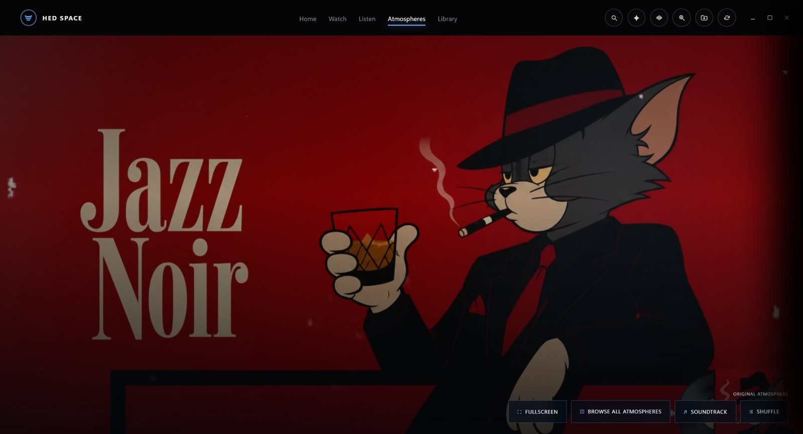
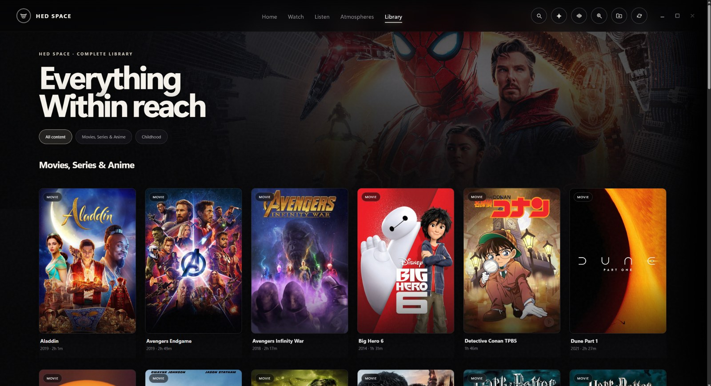
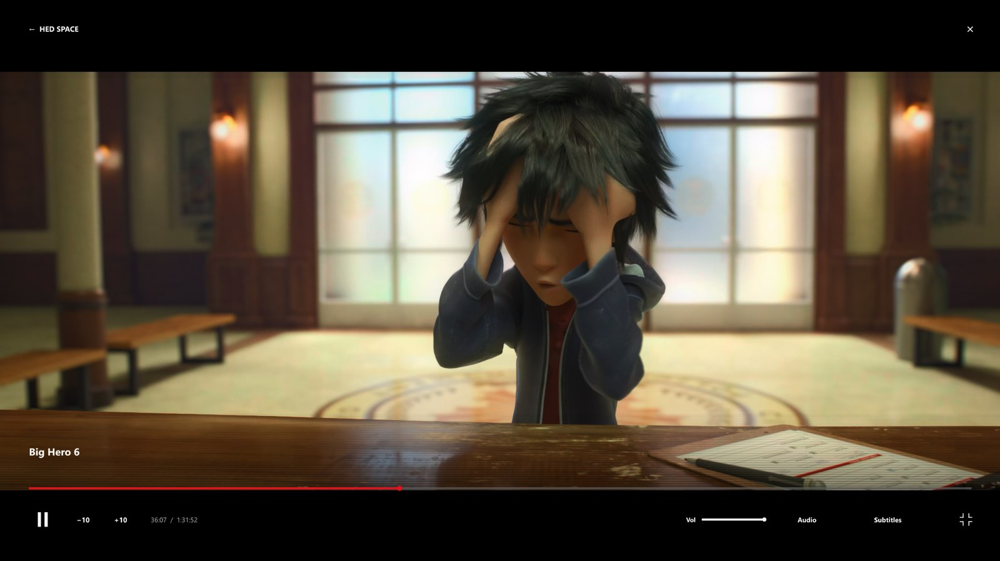
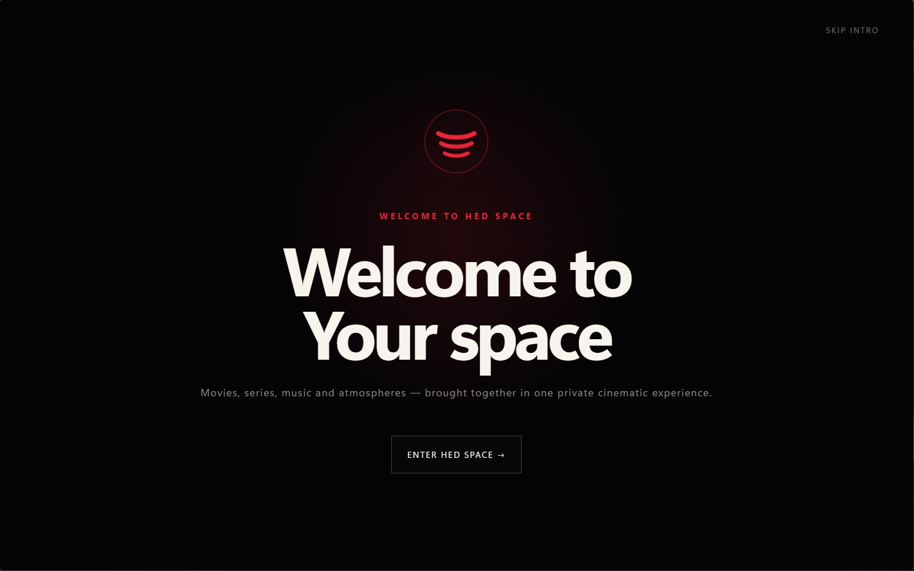
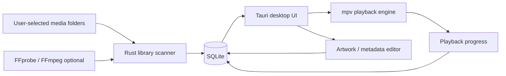

# HED Space Desktop

<p align="center">
  <strong>AI-assisted desktop engineering outside my primary Java stack.</strong><br>
  A local-first cinematic media library for Windows, built with coding agents while I owned product direction, review, validation, and delivery.
</p>

<p align="center">
  
  
  
  
  
  
</p>



> **AI engineering project:** My primary background is **Java full-stack development (Java, Spring Boot, Angular, SQL, DevOps)**. I intentionally used HED Space to test how effectively I could use **Codex and Hermes** to understand, build, debug, and validate software in a desktop stack outside my main expertise.

## Why this project matters

HED Space is not presented as proof that Rust/Tauri is my primary specialization. It is proof of a different engineering skill: **using coding agents responsibly to deliver working software in an unfamiliar codebase**.

My role remained the engineering owner: I defined product behavior, provided runtime feedback and screenshots, constrained scope, reviewed generated changes, tested the application, diagnosed failures with the agents, and decided when work met the acceptance criteria.

The development method is documented in [`docs/ai/`](docs/ai/README.md), including a case study, reusable workflow, prompt playbook, repository agent instructions, and my own Codex CLI field manual.

📘 **Field manual:** [Using Codex CLI Effectively — A Practical Manual for Safe, Reliable, Agent-Assisted Software Development](docs/ai/Using-Codex-CLI-Effectively.pdf)

## What the AI-assisted workflow demonstrates

| Capability | Evidence in this repository |
| --- | --- |
| Work in an unfamiliar stack | Tauri/Rust/SQLite/mpv desktop application outside my main Java stack |
| Repository exploration | Documented orient → investigate workflow and architecture mapping |
| Prompt/task design | Goal, context, boundaries, verification, deliverable pattern |
| Safe agent instructions | Root [`AGENTS.md`](AGENTS.md) with scope, verification, and security rules |
| Debugging with evidence | Diagnose-before-fix workflow and focused patch rules |
| UI iteration | Real runtime screenshots used as feedback for targeted UI changes |
| Verification | `scripts/validate-source.py`, Windows runtime checks, build checks, final diff review |
| Engineering ownership | Human-controlled acceptance, publishing, runtime verification, and risk decisions |

See [`docs/ai/AI-ENGINEERING-CASE-STUDY.md`](docs/ai/AI-ENGINEERING-CASE-STUDY.md) for the full breakdown.

## Product overview

**HED Space** is a private desktop media experience designed around media the user already owns and stores locally. Instead of browsing folders directly, it scans user-selected library locations, builds a local SQLite catalog, groups episodic content into series and seasons, tracks playback progress, manages artwork, and launches local playback through **mpv**.

The application is intentionally **local-first**: there is no media server requirement, no cloud catalog, and no remote account needed. Media stays in user-selected folders while HED Space keeps its library state locally.

> **Portfolio note:** screenshots in this repository show content from a private test library for UI demonstration only. No third-party movies, episodes, music, posters, or media binaries are distributed with the source code.

## Highlights

- Recursive scanning across multiple folders and drives.
- Movies, series, anime, and childhood collections grouped automatically.
- Season / episode detection for patterns such as `S01E02`, `1x02`, `Episode 01`, and anime-style numbering.
- Local SQLite database for library metadata, settings, and playback progress.
- Continue Watching with resume position and recent-history ordering.
- Custom posters, backdrops, episode thumbnails, song covers, and atmosphere artwork.
- Local music library and immersive Atmospheres mode.
- mpv-based movie and episode playback with a custom HED Space Lua OSC.
- Audio-track and subtitle selection, volume, seek controls, keyboard shortcuts, and next-episode flow.
- Optional FFmpeg/FFprobe integration for metadata, duration probing, and generated thumbnails/backdrops.
- Custom frameless Tauri desktop window and cinematic interface.

## Screenshots

| Watch | Atmospheres |
| --- | --- |
|  |  |

| Library | Player |
| --- | --- |
|  |  |

<details>
<summary>Welcome screen</summary>



</details>

## Architecture



### Main components

| Layer | Technology | Responsibility |
| --- | --- | --- |
| Desktop shell | Tauri 2 | Windowing, native commands, file dialogs, packaging |
| Backend | Rust | Scanning, SQLite access, player process control, metadata management |
| UI | HTML, CSS, JavaScript | Cinematic desktop interface and library interactions |
| Database | SQLite / `rusqlite` | Local catalog, settings, metadata, progress |
| Playback | mpv + Lua OSC | Local movie / episode playback |
| Media tools | FFprobe / FFmpeg | Optional probing and artwork extraction |

## Local-first data flow

```text
media on your drives
        ↓
HED Space scanner
        ↓
local SQLite catalog
        ↓
cinematic desktop library
        ↓
mpv playback
        ↓
saved resume progress
```

The application stores metadata and progress locally. It does **not** upload the user's media library to a remote service.

## Development setup

### Requirements

For the current Windows build:

- Windows 10/11
- Node.js + npm
- Rust stable with the MSVC toolchain
- Microsoft C++ Build Tools / Tauri Windows prerequisites
- WebView2
- `mpv.exe` for movie, episode, and fullscreen-atmosphere playback
- `ffprobe.exe` recommended for duration / tag probing
- `ffmpeg.exe` optional for generated thumbnails and backdrops

Third-party media binaries are deliberately **not bundled** in this repository.

Place binaries you already have in `src-tauri/bin/` or make them available on `PATH`.

```powershell
powershell -ExecutionPolicy Bypass -File .\scripts\prepare-tools.ps1
npm install
npm run dev
```

Build the Windows installer:

```powershell
npm run build
```

## Validation

The repository includes a source-level validator that checks JSON/config parsing, HTML parsing, JavaScript syntax, the SQLite schema, Tauri command wiring, library scanner expectations, and custom mpv OSC integration.

```powershell
python .\scripts\validate-source.py
```

The same validator runs in GitHub Actions on pushes and pull requests. Native Tauri/mpv behavior is still verified on Windows because desktop process control and playback cannot be proven by source validation alone.

## Repository structure

```text
.
├── .github/workflows/
│   └── validate.yml
├── AGENTS.md
├── app/
├── docs/
│   ├── ai/
│   │   ├── README.md
│   │   ├── AI-ENGINEERING-CASE-STUDY.md
│   │   ├── AGENT-WORKFLOW.md
│   │   ├── PROMPT-PLAYBOOK.md
│   │   └── Using-Codex-CLI-Effectively.pdf
│   ├── screenshots/
│   └── PROJECT_NOTES.md
├── scripts/
├── src-tauri/
├── package.json
├── FIRST_RUN.txt
└── VERSION.txt
```

## Privacy and repository hygiene

The repository intentionally excludes personal media files, user library databases, local media paths, mpv/FFmpeg binaries, generated build output, secrets, and environment files.

## Current status

**Current source version: `0.6.43`.**

The application is a Windows-focused personal desktop project. Source-level validation is automated; native Tauri/mpv behavior is tested on Windows.

For implementation history and earlier development notes, see [`docs/PROJECT_NOTES.md`](docs/PROJECT_NOTES.md).

## About my AI engineering approach

I wrote **Using Codex CLI Effectively**, a practical field manual covering repository orientation, prompt structure, explicit definitions of done, evidence-first investigation, proportional verification, Git/code review, repository instructions with `AGENTS.md`, permissions/security, MCP, subagents, automation, reusable prompt templates, failure modes, and safe human oversight.

The manual is included here because HED Space is a concrete application of that methodology rather than a claim that AI replaces engineering responsibility.

## License

Copyright © 2026 Houssam Elmouqaddam. All rights reserved.

This repository is published for portfolio and source-review purposes. No license is granted to copy, redistribute, sell, or repackage the project unless permission is provided by the copyright holder. See [`LICENSE.md`](LICENSE.md).
